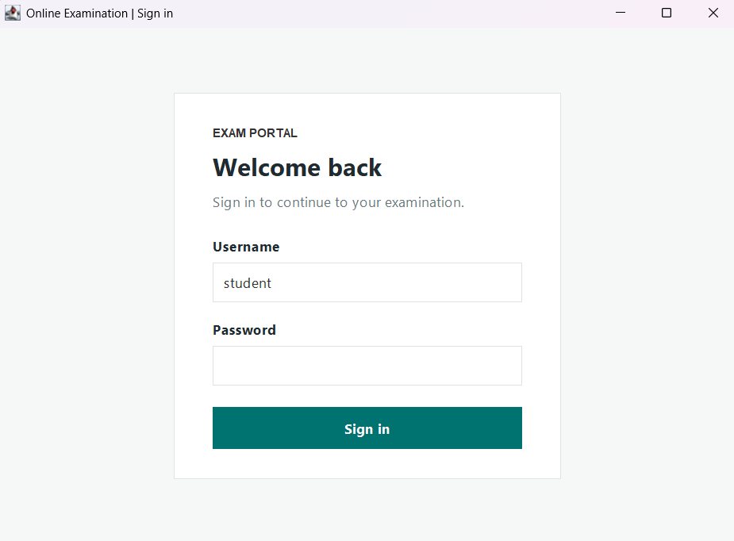
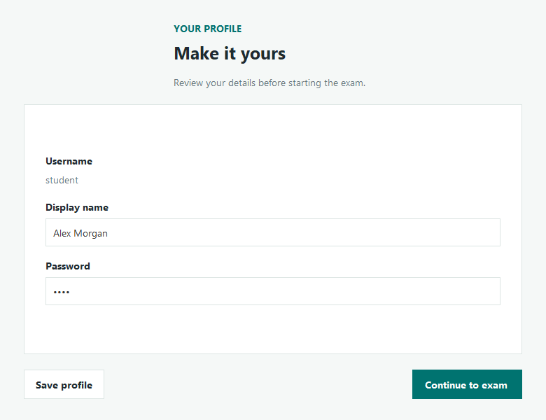
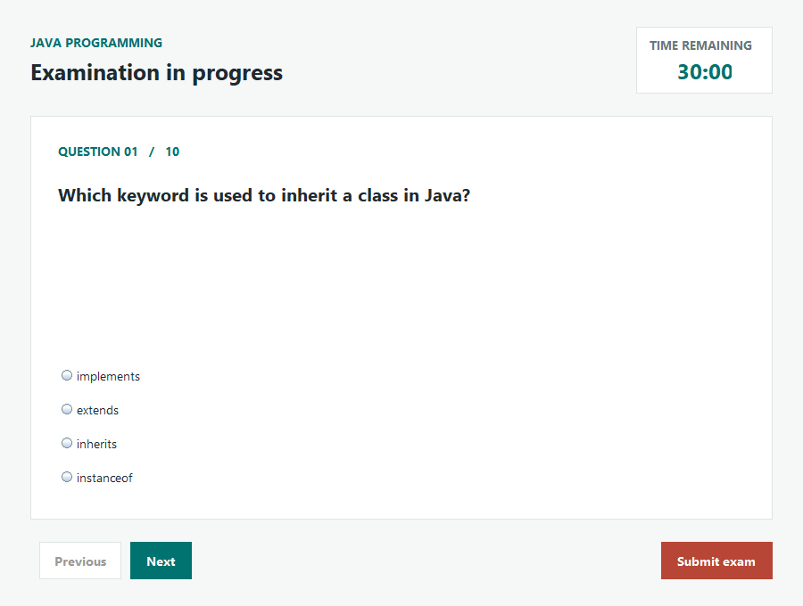
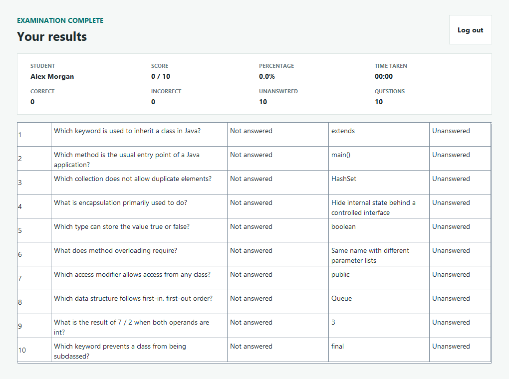

# Online Examination System

A desktop-based multiple-choice examination application built with Java Swing and AWT. The application guides a student through sign-in, profile review, a timed Java fundamentals exam, and a detailed results report.

## Project Objectives

- Provide a simple desktop interface for taking a multiple-choice examination.
- Demonstrate object-oriented Java and event-driven GUI programming.
- Track answers and examination time, then calculate and present the result.
- Organize the application as a Maven project with a small executable model test.

## Technologies

- **Java 17 or later** - application language and runtime (the Maven compiler target is Java 17).
- **Java Swing** - windows, forms, dialogs, timer, and results table.
- **Java AWT** - layout managers, colors, fonts, and other desktop UI primitives.
- **Apache Maven** - project build and compilation of the application and test sources.
- No external runtime libraries are declared in `pom.xml`.

## Implemented Features

- Sign in with the initial student account (`student` / `1234`) and show validation for missing or incorrect credentials.
- Review and update the student's display name and password before the exam. These changes remain in memory for the current application run; they are not saved to disk.
- Take a ten-question Java fundamentals multiple-choice exam, with four options per question.
- Move between questions while keeping selected answers.
- View a 30-minute countdown; the exam submits automatically when the timer reaches zero.
- Confirm before manual submission or quitting the exam window.
- View the score, percentage, time taken, correct/incorrect/unanswered totals, and each selected answer alongside the correct answer.
- Log out from the results screen and return to sign-in.

## Screenshots

The following screenshots are included in the repository:

| Screen | Preview |
| --- | --- |
| Sign in |  |
| Student profile |  |
| Examination |  |
| Results |  |

## Project Structure

```text
Java-Task-Online-Examination-System/
├── src/
│   ├── Main.java
│   ├── LoginFrame.java
│   ├── ProfileFrame.java
│   ├── ExamFrame.java
│   ├── ResultFrame.java
│   ├── Question.java
│   ├── User.java
│   ├── ExamManager.java
│   ├── ExamResult.java
│   └── Ui.java
├── test/
│   ├── ExamManagerTest.java
│   └── ScreenshotGenerator.java
├── screenshots/
│   ├── login.png
│   ├── profile.png
│   ├── exam.png
│   └── results.png
├── pom.xml
└── README.md
```

## Requirements

- JDK 17 or later, with `java` and `javac` available on `PATH`.
- Apache Maven 3.x, with `mvn` available on `PATH`.
- A desktop environment capable of displaying Java Swing windows.

Check the installed tools from a terminal:

```powershell
java -version
mvn -version
```

## Clone, Build, and Run

1. Clone the repository. Replace the placeholder with the repository URL:

    ```powershell
    git clone https://github.com/<your-username>/<your-repository>.git
    ```

2. Change to the project directory (use the actual cloned folder name if it differs):

    ```powershell
    cd Java-Task-Online-Examination-System
    ```

3. Compile the application and test sources with Maven:

    ```powershell
    mvn clean test
    ```

4. Start the Swing application:

    ```powershell
    java -cp target/classes Main
    ```

5. Sign in with **Username:** `student` and **Password:** `1234`.

The commands above are for PowerShell on Windows. The application can also be opened as a Maven project in an IDE; run `Main` to launch it.

## Testing

`test/ExamManagerTest.java` is a standalone smoke test, not a JUnit test. It checks the ten-question/four-option question bank, answer persistence, correct/incorrect/unanswered scoring, one-time submission, rejection of answer changes after submission, and countdown expiration with a short test duration.

After running `mvn clean test` to compile the sources, execute the smoke test on Windows with:

```powershell
java -cp "target/classes;target/test-classes" ExamManagerTest
```

On success, it prints `ExamManager tests passed.` Maven compiles the test source, but does not automatically execute this standalone `main` method. The screenshot generator is also a standalone helper; the screenshots shown above are existing image files.

## Initial Login

| Username | Password |
| --- | --- |
| `student` | `1234` |

This is a demo credential embedded in the application, not a production authentication system.

## Author

**Author:** [Your Name]

Replace `[Your Name]` with the submitting author's name before submission.